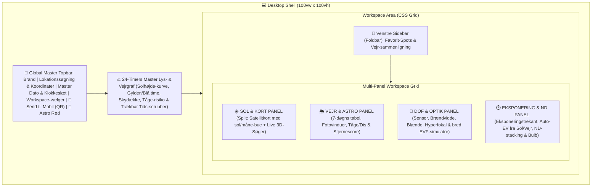
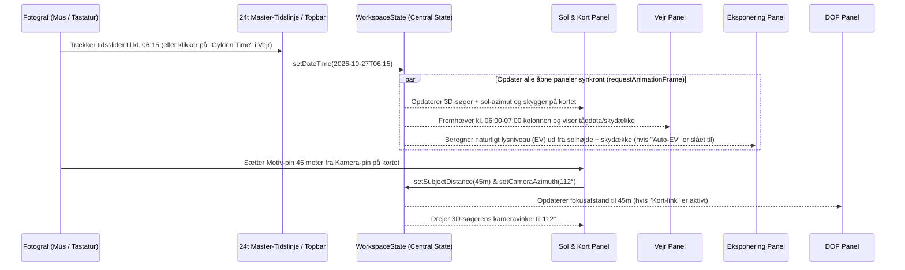

# Fotografiske Signaler – Desktop Edition: Arkitektur- & Designplan

> **Status:** Besluttet designgrundlag  
> **Leveranceform:** Selvstændigt Git-repository (`FotografiskeSignaler-Desktop`) som Web-baseret Desktop App / Desktop-PWA (`display: standalone`)  
> **Teknologistak:** Vite, TypeScript, Vanilla ES-moduler, HTML5 Canvas (Retina), CSS Grid/Subgrid, Leaflet (On-Demand/Dual-View)

---

## 1. Vision & Samspil mellem Desktop og Mobil

Desktop-udgaven og Mobil-udgaven udgør tilsammen et komplet økosystem for fotografen, men med to vidt forskellige arbejdssituationer:

| Dimension | 💻 Desktop Edition (*"Planlægnings-studiet"*) | 📱 Mobil Edition (*"Felt-værktøjet"*) |
| :--- | :--- | :--- |
| **Brugsscenarie** | Hjemmefra ved stor skærm (14"–32") før turen. Overblik, analyse, sammenligning af lokationer og finplanlægning. | Ude i naturen / i mørket med én hånd og evt. handsker på. Hurtige opslag og live-tjek. |
| **Skærm-paradigme** | **Multi-Panel Workspace:** Flere moduler er aktive og synlige samtidigt i et samlet Bento-dashboard eller Split-View. | **Single-Module View:** Ét modul ad gangen med bundnavigation og maksimal fokus. |
| **Tids- og lokationsstyring** | **Global Master-Synkronisering:** Én central tidslinje/scrubber og lokationsvælger opdaterer Vejr, Kort, 3D-Sol, DOF og Eksponering simultant i realtid (60 fps). | Lokationssynkronisering + konteksthop (*"Se lysretning i Sol"*). |
| **Overlevering (Handoff)** | Genererer QR-kode / dybt link med valgt koordinat, dato, klokkeslæt og kameravinkel. | Scanner QR-kode fra desktop-skærmen og åbner direkte på det planlagte shoot. |

> [!IMPORTANT]
> **Hvorfor separat repository?**  
> Mobil-udgaven ([`FotografiskeSignaler`](file:///Users/familie/Desktop/FotografiskeSignaler)) forbliver 100% urørt, slank og optimeret til feltbrug. I det nye desktop-repository kan hele skallen (`DesktopShell`), vinduesstyringen og multi-canvas renderingen bygges kompromisløst til store skærme uden risiko for regressioner i mobil-layoutet.

---

## 2. Overordnet Brugerflade & Workspace-Layout

På desktop erstattes mobilens smalle `max-width: 768px` kolonne og bundnavigation af en fuldskærms **Desktop Shell** (`100vw × 100vh` på store skærme med individuel panel-scroll og interaktive lærreder).



### De 3 Hurtige Workspace-Modes (i Topbaren)
Brugeren kan med ét klik i topbaren (eller via genvejstasterne `1`, `2`, `3`, `4`) skifte mellem:

1. **🎛️ Komplet Dashboard (Standard 2×2 Bento Grid):**
   * Alle 4 hovedmoduler (**Sol & Kort**, **Vejr**, **DOF**, **Eksponering**) er synlige samtidigt på skærmen.
2. **🗺️ Planlægning (50/50 eller 60/40 Split-Screen):**
   * Venstre/Midt: Stort kombineret **Satellitkort + 3D-søger + Måne/Mælkevej**.
   * Højre: Udvidet **Vejr- og Fotovindue-analyse** med detaljerede time-for-time grafer.
3. **📷 Kamera & Optik (Optisk Arbejdsbord):**
   * Fokus på **DOF (med ekstra stor EVF-søger)**, **Eksponeringstrekant + Histogram** og **3D-kompositionssøger** side om side.
4. **🔍 Fokus-visning (Maksimer enkeltpanel):**
   * Hvert panel har en `[ ⤢ ]` maksimer-knap i panelets tophjørne, så man midlertidigt kan folde ethvert modul ud i 100% arbejdsbredde.

---

## 3. Reaktiv Master-Synkronisering (`WorkspaceState`)

I mobil-udgaven pauser [`AppShell.ts`](file:///Users/familie/Desktop/FotografiskeSignaler/src/app/AppShell.ts) inaktive moduler via `onDeactivate()`, fordi kun ét modul er synligt. På desktop er flere moduler aktive samtidigt. Derfor indføres en central **`WorkspaceState` (Event Bus)**, som koordinerer alle åbne paneler uden lagg:



### Intelligente Kryds-koblinger mellem Modulerne
* **Vejr ↔ Sol & Kort:** Klik på enhver time eller et fotovindue (f.eks. *Morgentåge kl. 05:00* eller *Gylden Time kl. 17:10*) sætter straks Master-tiden, så kortet og 3D-søgeren viser solens og månens præcise placering i det øjeblik.
* **Sol & Vejr → Eksponering ("Auto-EV Link"):** En toggle-knap i Eksponerings-panelet (*"Hent EV fra Sol & Vejr"*). Når den er aktiv, udregnes scenens lysværdi (EV) automatisk ud fra solens højde over/under horisonten (dag, gylden time, blå time, nat) korrigeret for det aktuelle skydække i Vejr-modulet.
* **Kort → DOF ("Afstands-link"):** Mulighed for at klikke et målepunkt på kortet og sende afstanden direkte ind som fokusafstand i DOF-beregneren.

---

## 4. De 4 Desktop-Specifikke Udvidelser

### 4.1 Kombineret Sol- & Kort-panel (Dual-View)
På desktop slipper vi for at skifte fane mellem *3D-søger*, *2D Solur* og *Satellitkort*:
* **Venstre del af Sol-panelet:** Interaktivt Leaflet-kort (Satellit / Topografisk / Mørkt kort) med indtegnet **solopgangs-linje**, **solnedgangs-linje**, **aktuel sol-retning**, **skyggevektor** samt solens/månens bue hen over døgnet direkte oven på kortet.
* **Højre del af Sol-panelet (eller Picture-in-Picture):** Den roterbare Retina **3D-søger** og nøgletal (Azimut, Solhøjde, Skyggelængde-forhold), som opdaterer live, når man flytter pin'en på kortet eller trækker i tiden.

### 4.2 Visuel 24-Timers Lys- & Vejrgraf (Master Scrubber)
En bred, interaktiv tidslinje på tværs af dashboardet for det valgte døgn (`00:00` til `23:59`):
* **Baggrunds-farvebånd:** Astronomisk nat → Blå time → Gylden time → Dag → Gylden time → Blå time → Nat.
* **Kurver & Lag:** Solhøjde-kurve (og månehøjde-kurve) kombineret med time-for-time skydække (lav/mellem/høj) og markering af timer med høj tåge- eller stjerne-score.
* **Direkte Scrubbing:** Træk musen hen over grafen for at "spole" gennem døgnet og se skygger, solhøjde og vejr ændre sig flydende i alle paneler.

### 4.3 Favorit-Spots & Multi-Spot Vejrsammenligning (Venstre Sidebar)
* Gem ubegrænsede favorit-lokationer (f.eks. *"Møns Klint – Sommerspiret"*, *"Rubjerg Knude"*, *"Dyrehaven – Eremitageslottet"*) med koordinater, foretrukket kameravinkel og egne noter.
* **Spot-Sammenligner (Matrix):** Se en hurtig status-indikator ud for dine gemte spots for i dag/i morgen (f.eks. 🌅 *Gylden time score*, 🌫️ *Morgentåge-chancer*, ✨ *Nattehimmel*), så du på 5 sekunder kan vælge, *hvilken* lokation der har de bedste fotobetingelser i morgen tidlig.

### 4.4 Måne- & Mælkevejs-udvidelse i `AstroCore`
* Udvidelse af [`AstroCore.ts`](file:///Users/familie/Desktop/FotografiskeSignaler/src/shared/astronomy/AstroCore.ts) med:
  * **Månens azimut, højde samt opgangs- og nedgangstidspunkter** (og indtegning af måneretning på kortet og månen i 3D-søgeren).
  * **Mælkevejens Galaktiske Centrum (Sagitarius A*)** højde og azimut samt synlighedsvindue (hvornår både sol og måne er under horisonten, og galakse-kernen er over horisonten).

### 4.5 "Send til Mobil" – QR-kode & URL Handoff
* En knap i topbaren (`📱 Send til mobil`) åbner et lille modal-kort med:
  1. En **QR-kode** genereret direkte på canvas (100% offline, 0 eksterne biblioteker) der peger på mobil-PWA'ens URL med hash-parametre: `https://.../#!/sol?lat=55.676&lon=12.568&date=2026-10-27&time=06:45&az=115`.
  2. Et komprimeret **"Field Sheet" resumé** (Lokation, Solopgang, Gylden time, Valgt blænde/hyperfokal/ND-filter), som kan kopieres til udklipsholderen eller printes/gemmes.

---

## 5. Foreslået Mappestruktur for `FotografiskeSignaler-Desktop`

Vi genbruger hele den gennemtestede matematiske kerne fra mobil-projektet og bygger en dedikeret desktop-skal udenpå:

```text
FotografiskeSignaler-Desktop/
├── public/
│   ├── icons/
│   ├── manifest.webmanifest          # Desktop-optimeret PWA manifest (window-controls)
│   └── fotografiske-signaler-wordmark.png
├── src/
│   ├── app/
│   │   ├── DesktopShell.ts           # Topbar, Workspace-switcher, Sidebar, Grid-layout
│   │   ├── WorkspaceState.ts         # Central reaktiv state (Lokation, Dato/Tid, Kamera, Links)
│   │   ├── TimelineBar.ts            # 24-timers interaktiv Lys- & Vejrgraf (Canvas/SVG)
│   │   ├── SpotsSidebar.ts           # Favorit-spots bibliotek & Multi-spot vejrsammenligner
│   │   └── MobileHandoffModal.ts     # QR-kode generator & Field Sheet eksport
│   ├── shared/
│   │   ├── astronomy/
│   │   │   └── AstroCore.ts          # Delt med mobil + udvidet med Måne-azimut & Mælkevej
│   │   ├── services/
│   │   │   ├── LocationService.ts    # Delt med mobil
│   │   │   ├── TimeService.ts        # Delt med mobil
│   │   │   ├── SpotsService.ts       # NY: Persistens og batch-vejrkald for favorit-spots
│   │   │   └── StorageService.ts     # Udvidet med workspace-layout præferencer
│   │   └── styles/
│   │       ├── variables.css         # Samme design-DNA + desktop grid-tokens
│   │       ├── desktop-shell.css     # Widescreen Bento-grid, split-paneler & scrollbars
│   │       └── components.css
│   ├── panels/                       # Desktop-paneler (kan være mounted samtidigt)
│   │   ├── sun-map/                  # Kombineret Satellitkort + 3D-Søger + 2D Solur
│   │   ├── weather/                  # Widescreen Vejr-analyse & Fotovinduer
│   │   ├── dof/                      # Widescreen DOF + Stor EVF simulator
│   │   └── exposure/                 # Eksponering + Auto-EV kobling + ND + Bulb
│   └── main.ts
├── tests/                            # Vitest suite (DOF, Sol, Vejr, Måne/Mælkevej)
├── index.html
├── vite.config.ts
├── tsconfig.json
└── package.json
```

---

## 6. Etapeplan for Implementering (Fase 1 → 4)

### 🚀 Fase 1: Nyt Repository, Desktop Shell & 4-Modul Bento Dashboard
1. Opret `/Users/familie/Desktop/FotografiskeSignaler-Desktop` som selvstændigt Git-repository og kopiér kerneberegninger, tests og styles fra mobil-projektet.
2. Byg `WorkspaceState.ts` og `DesktopShell.ts` med:
   * Fast Widescreen Topbar (Global lokationssøgning, GPS, Datovælger, Klokkeslæt-slider, Workspace-vælger: *Komplet Dashboard*, *Planlægning*, *Kamera & Optik*, samt *Astro Rød Nattilstand*).
   * Multi-panel montering så alle 4 moduler kører simultant på én skærm med individuelle `[ ⤢ Maksimer ]`-knapper.
3. Ombyg **Sol-panelet** til desktop Dual-View (Leaflet Satellitkort med indtegnede sol-linjer/skygger side-om-side med 3D-søgeren).
4. Tilpas **Vejr**, **DOF** og **Eksponering** til widescreen-paneler og kobl dem på `WorkspaceState` (inkl. *Auto-EV fra Sol/Vejr*).

### 📈 Fase 2: 24-Timers Master Lys- & Vejrgraf + Mobil QR-Handoff
1. Byg `TimelineBar.ts`: Interaktiv 24-timers graf under topbaren med solhøjde-kurve, gylden/blå time-zoner, skydække og tåge-markører, hvor man kan trække tiden live.
2. Byg `MobileHandoffModal.ts`: Offline QR-kode-generator og direkte URL-link til mobil-PWA'en (samt et lille 10-linjers tjek i mobil-repoet så URL-parametre indlæser tid og koordinat direkte).

### 📌 Fase 3: Favorit-Spots Sidebar & Multi-Spot Vejrsammenligning
1. Byg `SpotsService.ts` og `SpotsSidebar.ts` (foldbar venstre-sidebar).
2. Mulighed for at gemme favorit-lokationer med navn, koordinat, foretrukket kameraretning og noter.
3. Sammenlignings-oversigt der henter og rangerer fotovinduer (Gylden time / Morgentåge / Stjerner) på tværs af fotografens gemte spots.

### 🌌 Fase 4: Astro-Udvidelse (Månebane & Mælkevej)
1. Udvid `AstroCore.ts` med præcis måne-azimut/højde, måneopgang/nedgang og Galaktisk Centrum (Mælkevejens kerne).
2. Vis måne- og mælkevejs-retning direkte på satellitkortet, i 24-timers grafen og i 3D-søgeren.
